# 🎨 Awesome Image Editing

### Curated Directory of SaaS Solutions, AI Retouching Engines & Open-Source Image Editing Ecosystems

  <b>Discover top raster manipulation software, photo editors, digital painting suites, RAW developers, and AI-powered upscaling tools.</b> 
  <i>Whether you need a cloud-hosted SaaS platform or a 100% free, self-hosted open-source Photoshop alternative.</i>

---

## 📑 Table of Contents

- [📊 Sector Overview & Market Dynamics](#-sector-overview--market-dynamics)
- [☁️ SaaS/Hosted Platforms](#️-saashosted-platforms)
- [💻 Open-Source GitHub Projects](#-open-source-github-projects)
  - [⭐ Top Open-Source Projects (Ranked by Stars)](#-top-open-source-projects-ranked-by-stars)
  - [🛠️ Additional Open-Source Options & Frameworks](#️-additional-open-source-options--frameworks)
- [🤝 How to Contribute](#-how-to-contribute)
- [💖 Support & Sponsoring](#-support--sponsoring)
- [📈 Star History](#-star-history)
- [⚠️ Disclaimer](#️-disclaimer)

---

## 📊 Sector Overview & Market Dynamics

The global photo editing and digital image software market was valued at approximately **$1.15B to $1.2B in 2024** (surpassing **$14B+** when encompassing wider digital media suites, generative AI graphics, and creator platforms) with an expected compound annual growth rate (**CAGR of 8–10%**) projected through 2030.

The industry showcases a **highly concentrated, "winner-take-most" dynamic** in professional enterprise creative studios anchored by Adobe's suite lock-in. Concurrently, it displays **moderate fragmentation** across prosumer, browser-based, mobile, and social media creative workflows led by Canva, with rapidly growing demand for privacy-first, non-subscription, and open-source alternatives.

---

## ☁️ SaaS/Hosted Platforms

| 🚀 Product | 🏢 Company Valuation / Revenue | 💳 Starting Tier Pricing | 🎁 Free Tier Limits / Free Trial | 📝 Description |
| :--- | :--- | :--- | :--- | :--- |
| **[Adobe Photoshop](https://www.adobe.com/products/photoshop.html)** | ~$146.5B Market Cap / $23.8B Revenue (Adobe FY25) | $22.99/mo (annual commitment) or $19.99/mo (Photography plan) | 7-day free trial with full feature access (requires payment info; auto-renews unless canceled) | Industry standard for professional raster image editing, layer compositing, and generative AI features. |
| **[Canva](https://www.canva.com/)** | $42B Valuation / ~$3.5B ARR (2025) | $15.00/mo or $120.00/yr ($10/mo billed annually) for Canva Pro | Free-for-life tier with 5 GB storage, ~1.6M templates; limited to basic exports (no background remover, magic resize, or transparent PNGs) | Browser-based design and visual communication platform with drag-and-drop templates and AI tools. |
| **[Affinity Photo](https://affinity.serif.com/photo/)** | ~$380M Acquisition by Canva (2024) | Free core suite (Canva Pro from $15/mo for integrated AI features) | Free-for-life core application access via free Canva account login; optional paid Canva subscription for cloud AI features | Professional raster editing, RAW development, and layered compositing suite without subscription fees for core tools. |
| **[Skylum Luminar Neo](https://skylum.com/luminar)** | ~$55M–$60M Implied Valuation / ~$18M ARR | $9.95/mo (billed annually at $119/yr) or $14.95/mo monthly | 7-day free trial covering core application and AI tools (watermark/resolution restrictions may apply to exports) | AI-centric photo editor featuring generative tools, sky replacement, relighting, and portrait enhancement. |
| **[Pixlr](https://pixlr.com/)** | ~$9.1M Revenue (Subsidiary of Inmagine Group) | $1.99/mo (Plus Plan, billed annually at $23.88/yr) or $2.49/mo | Free-for-life tier with ad-supported interface, limited to ~3 saves per day and 20 starter AI credits | Browser-based photo editor providing quick raster manipulation, templates, and lightweight AI utilities. |
| **[Photopea](https://www.photopea.com/)** | Bootstrapped solo venture / ~$2M+ Annual Revenue | $5.00/mo (Single User Premium) or $15.00/quarter | Free-for-life tier with full tool access and no watermarks; includes sidebar ads and 0.5 GB PeaDrive cloud storage limit | Web-based Photoshop clone offering deep PSD/PSB compatibility, full layer controls, and zero software installation. |

---

## 💻 Open-Source GitHub Projects

### ⭐ Top Open-Source Projects (Ranked by Stars)

Every major active open-source project for self-hosting, avoiding subscription lock-in, and transparent image manipulation. Sorted descending by GitHub_Stars_Count:

1. **[Upscayl](https://github.com/upscayl/upscayl)**   
   **The #1 AI Image Upscaler.** Free and open-source desktop application (Linux, macOS, Windows) powered by neural networks. Upscales, sharpens, and restores low-resolution images locally on your GPU without cloud subscriptions or privacy leaks.

2. **[InvokeAI](https://github.com/invoke-ai/InvokeAI)**   
   **The creative engine for AI image generation and editing.** Features an industry-leading visual canvas UI with unified layers, inpainting, outpainting, sketch-to-image, and generative fill designed specifically for digital artists and creative studios.

3. **[Graphite](https://github.com/GraphiteEditor/Graphite)**   
   **Procedural 2D graphics and image editor.** Modern in-browser/desktop application combining raster image editing, digital painting, and vector graphics through an entirely non-destructive node graph engine written in Rust.

4. **[PhotoGIMP](https://github.com/Diolinux/PhotoGIMP)**   
   **The Photoshop-to-GIMP bridge.** A complete patch for GIMP that reconstructs the UI to match Photoshop's workspace, tool placements, dark theme, and standard keyboard shortcuts (Ctrl+T, Ctrl+D). Eliminates muscle memory friction for transitioning Photoshop users.

5. **[darktable](https://github.com/darktable-org/darktable)**   
   **The open-source Lightroom replacement.** Powerful photography workflow manager and non-destructive virtual lighttable and darkroom for RAW image processing, color management, and tone curve corrections.

6. **[Krita](https://github.com/KDE/krita)** [?style=social&color=white](https://github.com/KDE/krita/stargazers)  
   **The digital painting powerhouse.** Complete creative studio offering state-of-the-art brush engines, layered editing, non-destructive masks, vector text, color wheel controls, and an animation timeline built by the KDE community.

7. **[GIMP](https://github.com/GNOME/gimp)**   
   **The veteran GNU Image Manipulation Program.** The cornerstone of open-source raster graphics. GIMP 3.0 delivers non-destructive filter editing, multi-layer selection, native color management, and support for modern formats like JPEG XL and WebP.

8. **[chaiNNer](https://github.com/chaiNNer-org/chaiNNer)**   
   **Node-based programmatic image processing pipeline.** Highly customizable GUI for chaining batch image tasks, running neural network transformations, alpha channel handling, color space conversions, and image upscaling algorithms.

9. **[RawTherapee](https://github.com/Beep6581/RawTherapee)**   
   **Advanced RAW photo developer.** Cross-platform 32-bit floating-point processing engine designed for high-fidelity photo developing with demosaicing algorithms, advanced sharpening, tone curves, and lens correction profiles.

10. **[Pinta](https://github.com/PintaProject/Pinta)**   
    **Lightweight, accessible image editor.** Simple yet capable GTK-based paint and image manipulation tool modeled after Paint.NET. Supports layers, undo history, drawing tools, and essential visual effects.

11. **[PhotoDemon](https://github.com/tannerhelland/PhotoDemon)**   
    **Portable professional photo editor for Windows.** 100% portable with zero install requirements, featuring multi-layer editing, advanced masks, batch processing, and industry-leading PSD file support.

12. **[Scribus](https://github.com/scribusproject/scribus)**   
    **Open-source desktop publishing suite.** Built for professional print layout and page design (brochures, magazines, newsletters) with CMYK separation, ICC color management, and PDF/X-1a prepress export.

13. **[Bitmappery](https://github.com/igorski/bitmappery)**   
    **Minimalist browser-based raster canvas.** Self-hostable web editor featuring layers, selection masks, procedural filters, sprite sheet editing tools, and direct PSD import/export.

---

### 🛠️ Additional Open-Source Options & Frameworks

- **PhotoSplice** — High-performance Rust-powered image editor optimized for 1:1 Photoshop CS6 compatibility, PSD/PSB round-tripping, and GPU acceleration without Electron.
- **ImageMagick** — The ubiquitous CLI swiss army knife for programmatic image manipulation, batch resizing, format conversions, and pipeline scripting.
- **libvips** — Extremely fast, low-memory demand image processing library ideal for high-throughput automated web resizing and processing workflows.

---

## 🤝 How to Contribute

Contributions are warmly welcomed! Help make this the most comprehensive guide to creative image editing:

1. 🍴 **Fork** this repository.
2. 🌿 Create a feature branch: `git checkout -b add/my-awesome-editor`
3. ✏️ Add or update entries in `README.md` following the existing format.
4. 🚀 Submit a **Pull Request** with a brief overview of why the tool deserves inclusion.

---

## 💖 Support & Sponsoring

If you found this curated list helpful for your creative workflow or development pipeline, please consider showing your support:

- ⭐ **Star this repository** to help others discover it on GitHub.
- 🍴 **Fork and share** the repo with photographers, designers, and developer communities.
- ☕ **Buy me a coffee / Sponsor**: If you'd like to support ongoing maintenance and new open-source initiatives, visit the [**GitHub Sponsors Dashboard**](https://github.com/sponsors/ishandutta2007).

Your backing keeps this project actively updated and independent! ✨

---

## 📈 Star History

---

## ⚠️ Disclaimer

- This repository is a **community-curated guide** intended for informational and educational purposes.
- **PhotoGIMP** is a configuration and asset patch for GIMP rather than an independent software build.
- **GIMP 3.0** brings substantial API modernizations; verify legacy script and third-party plugin compatibility before production migrations.
- Always review licensing agreements and data policies when utilizing cloud AI features in commercial projects.

---

  <b>Built with ❤️ for photographers, designers, artists, and advocates of open creative tools.</b> 
  Let's make image editing more accessible, independent, and Photoshop-familiar.

